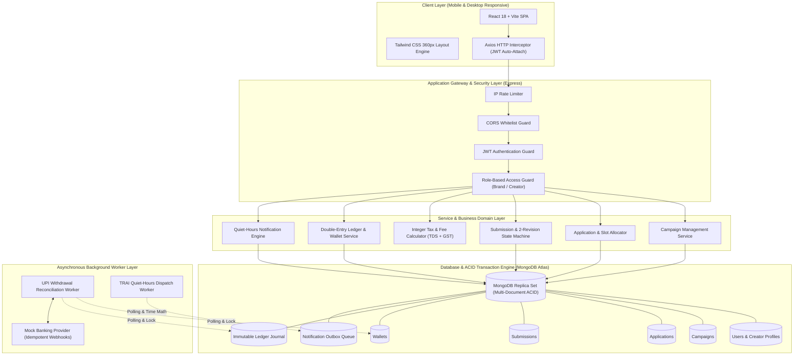
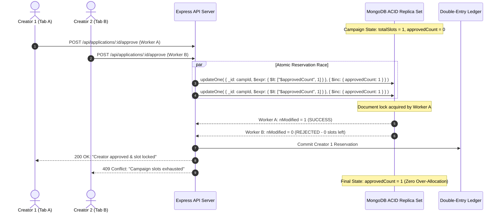

# PayPost: Campaign Deliverables & Financial Settlement Engine

<div align="center">


<p align="center">
  <b>A Production-Grade Creator-Brand Campaign Deliverables & Real-Time Financial Settlement Platform</b><br/>
  <i>Engineered for Indian Creator Ecosystems (Inspired by UGCIndia) with Strict Concurrency Safety, Zero-Creation Financial Ledger, Dynamic Tax Engine, and Mobile-First Architecture.</i>
</p>

[🌐 Live Frontend Demo (Vercel)](https://pay-post.vercel.app) • [⚙️ Live API Gateway (Render)](https://paypost.onrender.com/api/health) • [📖 Technical Documentation](docs/DOCUMENTATION.md) • [📊 25 Diagrams](docs/diagrams/README.md) • [📋 Test Cases Matrix](docs/TEST_CASES.md) • [🧪 Testing Guide](docs/TESTING.md)

</div>

---

## 🚀 Live Deployments & Cloud Architecture

| Component | Platform | Status | Live Endpoint / Access |
|---|---|---|---|
| **Frontend Web Application** | **Vercel** | [](https://pay-post.vercel.app) | [pay-post.vercel.app](https://pay-post.vercel.app) |
| **Backend API Gateway & Workers** | **Render** | [](https://paypost.onrender.com/api/health) | [paypost.onrender.com](https://paypost.onrender.com) |
| **Transactional Database** | **MongoDB Atlas** | [](#) | *Provisioned via Cloud Replica Set (Multi-Document ACID Enabled)* |
| **API Health Check** | Render Gateway | [](#) | [`GET /api/health`](https://paypost.onrender.com/api/health) |

> 🔒 **Security Notice**: *Database connection strings, JWT private keys, and credential secrets are strictly decoupled from version control and injected via encrypted cloud environment variable managers (Render Environment Secrets & Vercel Project Environment Variables). MongoDB Atlas connection strings are never exposed in public repositories.*

---

## 🎯 Problem Statement vs. PayPost Solution

| # | Industry Problem in Creator Platforms | Root Cause | PayPost Architectural Solution |
|---|---|---|---|
| **1** | **Over-allocation & Slot Stealing** | Read-then-write race conditions when multiple creators apply simultaneously. | **Atomic Conditional Reservation**: MongoDB `$expr: { $lt: ["$approvedCount", "$totalSlots"] }` in a single ACID update guarantees zero slot leaks. |
| **2** | **Floating-Point Financial Drifts** | Using standard JS floating math (`0.1 + 0.2 !== 0.3`) for rupees causes rounding loss. | **Integer Paise Rule**: Every single balance, payout, tax, and fee is stored and calculated strictly as integer paise (`₹1 = 100 paise`). |
| **3** | **Unbalanced Ledger / Money Duplication** | Wallet balance credited without audit trail; server crash duplicates payouts. | **Immutable Double-Entry Ledger**: Every rupee credited or debited writes a strictly balanced, immutable journal entry with 0-sum system invariants. |
| **4** | **Never-Ending Review Cycles** | Brands trap creators in infinite revision loops without paying. | **Two-Revision Hard Cap**: Strict state machine enforcing a maximum of 2 revision rounds with mandatory feedback; triggers automatic escalation. |
| **5** | **Ghost Withdrawals / Double Spends** | Creators withdraw twice before external banking gateways return settlement status. | **Two-Phase Hold-and-Settle UPI**: Funds transition to `heldPaise` instantly; reconciled asynchronously via idempotent background workers. |
| **6** | **Unlawful Spam During Sleep Hours** | Automated notifications wake up creators at 2 AM, violating TRAI statutory regulations. | **IST Quiet-Hours Outbox**: Zero-dependency pure UTC time math (+330 min) holds transactional alerts between 9:00 PM and 9:00 AM IST. |
| **7** | **Heavy, Sluggish Mobile Interfaces** | Bulky desktop dashboards squeezed down to mobile screens break layout. | **Mobile-First 360px Design**: Custom responsive card streams, bottom tab bars, and bottom sheets engineered without heavy third-party UI libraries. |

---

## 🏗️ High-Level System Architecture



---

## 🛠️ Complete Technology Stack

| Layer | Technology | Version | Architectural Rationale |
|---|---|---|---|
| **Runtime** | **Node.js** | `>= 18.x` | Enterprise-standard JavaScript runtime with asynchronous I/O and event loop efficiency. |
| **API Framework** | **Express.js** | `^4.19.2` | Minimalist HTTP routing engine decoupling controllers, services, and models. |
| **Database** | **MongoDB Atlas** | `v7.0+` | Cloud Document Database providing Multi-Document ACID Transactions across Replica Sets. |
| **ODM** | **Mongoose** | `^8.3.0` | Schema definition, automatic validation rules, pre-save hooks, and session-aware querying. |
| **Authentication** | **JWT (jsonwebtoken)** | `^9.0.2` | Stateless, cryptographic access tokens carrying user identity and role claims. |
| **Password Security** | **Bcrypt.js** | `^2.4.3` | Cryptographic salted one-way hashing protecting user passwords against rainbow tables. |
| **Frontend Framework** | **React** | `^18.3.1` | Declarative component UI engine with Virtual DOM reconciliation. |
| **Build Tool** | **Vite** | `^5.4.0` | Ultra-fast ESM-based local development server and optimized rollup production bundler. |
| **Styling** | **Tailwind CSS** | `^3.4.1` | Utility-first CSS framework compiled down to minimal byte size without bloated UI runtimes. |
| **Client Routing** | **React Router DOM** | `^6.23.0` | Declarative client-side routing, protected auth guards, and URL query parameter tracking. |
| **Testing Framework** | **Jest** | `^29.7.0` | Fast, deterministic test runner with built-in code coverage, mocks, and snapshot capabilities. |
| **In-Memory Testing** | **mongodb-memory-server** | `^9.1.8` | Boots isolated in-memory MongoDB replica sets per test run without cloud latency. |
| **Deterministic PRNG**| **mulberry32 algorithm** | Native | Seeded pseudo-random number generator powering the 100-action concurrency chaos engine. |

---

## 💰 Indian Statutory Tax & Financial Math Engine

All financial transactions are calculated strictly in **Integer Paise** (`₹1.00 = 100 paise`). The platform implements statutory deductions governed by Indian Income Tax (Section 194J/194C) and GST laws.

### Mathematical Deduction Breakdown

For a campaign milestone deliverable approved at gross reward $G$:

$$\text{Platform Fee } (PF) = \left\lfloor G \times 10\% \right\rfloor$$
$$\text{GST on Platform Fee } (GST) = \left\lfloor PF \times 18\% \right\rfloor$$
$$\text{TDS Statutory Deduction } (TDS) = \left\lfloor G \times 1\% \right\rfloor$$
$$\text{Net Creator Take-Home } (N) = G - PF - GST - TDS$$

### Numerical Proof Matrix

| Component | Rate | Formula | Amount (₹) | Integer Value (Paise) |
|---|---|---|---|---|
| **Gross Campaign Payout** | 100% | $G$ | **₹5,000.00** | `500,000` |
| **Platform Commission** | 10% | $\lfloor G \times 0.10 \rfloor$ | ₹500.00 | `50,000` |
| **GST on Commission** | 18% | $\lfloor PF \times 0.18 \rfloor$ | ₹90.00 | `9,000` |
| **TDS Withholding** | 1% | $\lfloor G \times 0.01 \rfloor$ | ₹50.00 | `5,000` |
| **Creator Net Credit** | **87.2%** | $G - PF - GST - TDS$ | **₹4,360.00** | **`436,000`** |

$$\text{Financial Invariant Proof: } 436,000 + 50,000 + 9,000 + 5,000 = 500,000 \text{ paise } (\Delta = 0)$$

---

## ⚡ Concurrency & Race Condition Defense Matrix

PayPost was designed from day one to withstand aggressive concurrent traffic spikes (such as thousands of creators applying for limited slots during a viral brand launch).



| Vulnerability Vector | Classic Failure Mode | PayPost Concurrency Defense | Tested In |
|---|---|---|---|
| **Simultaneous Slot Grab** | 50 applicants approved for 5 slots due to parallel `find()` then `save()`. | **Single-Statement Atomic `$expr`**: Database-level conditional increment; exactly $N$ succeed, all remaining fail. | [`tests/application.test.js`](file:///d:/PayPost/backend/tests/application.test.js) |
| **Submit vs Withdraw Race** | Creator submits Instagram reel while simultaneously withdrawing application in another tab. | **Document State Precondition Lock**: Submission checks `status === 'APPROVED'`; withdrawal locks and transitions status in a single atomic query. | [`tests/submission.test.js`](file:///d:/PayPost/backend/tests/submission.test.js) |
| **Double Payout Withdrawal** | User clicks "Withdraw" twice rapidly; two ₹500 transactions spawn on a ₹500 balance. | **Two-Phase Hold-and-Settle**: Available balance immediately decremented to `heldBalance` inside an ACID transaction; duplicate calls get `400 Insufficient Available Balance`. | [`tests/withdrawal.test.js`](file:///d:/PayPost/backend/tests/withdrawal.test.js) |
| **Worker Crash & Duplicate Payout** | Server restarts while bank payout is in-flight. | **Idempotent Reconciliation Worker**: Polls `HOLD` records with timestamps older than 60s; recovers state via provider reference or refunds wallet safely. | [`tests/withdrawal.test.js`](file:///d:/PayPost/backend/tests/withdrawal.test.js) |

---

## 📚 Exhaustive Diagrams Directory (25 Master Diagrams)

A dedicated, comprehensive architectural library is documented with full visual Mermaid charts and mathematical explanations in [`docs/diagrams/`](docs/diagrams/README.md):

| # | Diagram Document | Flow Description & Architectural Purpose |
|---|---|---|
| **01** | [01-system-topology.md](docs/diagrams/01-system-topology.md) | Component architecture across React SPA, Express gateway, MongoDB ACID sessions, and workers. |
| **02** | [02-campaign-lifecycle.md](docs/diagrams/02-campaign-lifecycle.md) | Full chronological lifecycle from campaign brief to UPI bank payout settlement. |
| **03** | [03-atomic-reservation-race.md](docs/diagrams/03-atomic-reservation-race.md) | Atomic reservation flowchart showing single-statement `$expr` update preventing slot over-allocation. |
| **04** | [04-submission-revision-state-machine.md](docs/diagrams/04-submission-revision-state-machine.md) | State machine of deliverable review lifecycle enforcing the strict 2-revision hard cap. |
| **05** | [05-money-flow-and-ledger.md](docs/diagrams/05-money-flow-and-ledger.md) | Financial flow chart demonstrating double-entry accounting and integer paise conservation. |
| **06** | [06-two-phase-withdrawals.md](docs/diagrams/06-two-phase-withdrawals.md) | Two-phase hold-and-settle sequence diagram for asynchronous UPI disbursements. |
| **07** | [07-notification-outbox-quiet-hours.md](docs/diagrams/07-notification-outbox-quiet-hours.md) | Transactional outbox pattern eliminating dual-write bugs with pure UTC quiet-hours math. |
| **08** | [08-database-er-model.md](docs/diagrams/08-database-er-model.md) | **Complete Entity-Relationship (ER) Diagram** covering all 8 collections, indexes, and relations. |
| **09** | [09-auth-and-rbac-flow.md](docs/diagrams/09-auth-and-rbac-flow.md) | User authentication, bcrypt salted hashing, JWT claims, and role-based route security. |
| **10** | [10-campaign-creation-and-funding-logic.md](docs/diagrams/10-campaign-creation-and-funding-logic.md) | Brief creation, deadline validations, and budget-per-creator funding integrity checks. |
| **11** | [11-campaign-post-approval-edit-rules.md](docs/diagrams/11-campaign-post-approval-edit-rules.md) | Safeguards preventing brands from reducing payouts or slots after creators have been accepted. |
| **12** | [12-campaign-cancellation-and-creator-protection.md](docs/diagrams/12-campaign-cancellation-and-creator-protection.md) | Brand campaign cancellation barriers protecting creators with active in-progress deliverables. |
| **13** | [13-creator-reapplication-decision-matrix.md](docs/diagrams/13-creator-reapplication-decision-matrix.md) | Decision logic governing when creators can reapply without slot-grabbing exploits. |
| **14** | [14-submit-vs-withdraw-race-condition.md](docs/diagrams/14-submit-vs-withdraw-race-condition.md) | ACID mutual exclusion between deliverable submission and application withdrawal. |
| **15** | [15-instagram-url-validation-and-deduplication.md](docs/diagrams/15-instagram-url-validation-and-deduplication.md) | Instagram Post/Reel URL regex sanitization and campaign-wide link deduplication. |
| **16** | [16-statutory-tax-and-fee-deduction-engine.md](docs/diagrams/16-statutory-tax-and-fee-deduction-engine.md) | Step-by-step integer paise computation pipeline for platform commission, GST, and TDS. |
| **17** | [17-double-entry-wallet-credit-settlement.md](docs/diagrams/17-double-entry-wallet-credit-settlement.md) | Multi-document ACID session executing deliverable approval, wallet credit, and ledger commit. |
| **18** | [18-withdrawal-two-phase-hold-and-settle.md](docs/diagrams/18-withdrawal-two-phase-hold-and-settle.md) | State transitions from `availableBalance` to `heldBalance` to bank settlement or refund. |
| **19** | [19-withdrawal-worker-polling-and-reconciliation.md](docs/diagrams/19-withdrawal-worker-polling-and-reconciliation.md) | Background worker polling loops, out-of-session banking API calls, and crash recovery. |
| **20** | [20-pure-utc-quiet-hours-time-arithmetic.md](docs/diagrams/20-pure-utc-quiet-hours-time-arithmetic.md) | Timezone calculation adding +330 min to UTC to strictly evaluate IST quiet windows (21:00-09:00). |
| **21** | [21-notification-dispatch-and-opt-out-pipeline.md](docs/diagrams/21-notification-dispatch-and-opt-out-pipeline.md) | Worker polling, send-time user opt-out checks, quiet-hours deferral, and mock dispatch. |
| **22** | [22-brand-action-center-aggregation-query.md](docs/diagrams/22-brand-action-center-aggregation-query.md) | Single-trip MongoDB aggregation query driving the Brand Action Center dashboard. |
| **23** | [23-creator-next-actions-urgency-engine.md](docs/diagrams/23-creator-next-actions-urgency-engine.md) | Priority weighting algorithm generating the Creator Next Actions banner (deadlines, revisions). |
| **24** | [24-deep-link-auto-focus-and-scroll-flow.md](docs/diagrams/24-deep-link-auto-focus-and-scroll-flow.md) | URL deep-link handling (`?tab=submissions&focus=<id>`) with tab switching and pulse glow. |
| **25** | [25-seeded-concurrency-chaos-test-engine.md](docs/diagrams/25-seeded-concurrency-chaos-test-engine.md) | Deterministic PRNG (`mulberry32`) chaos test verifying ledger invariants across 100 actions. |

---

## 💻 Local Setup & Quick Start

### 1. Prerequisites
- **Node.js**: `v18.0.0` or higher
- **npm**: `v9.0.0` or higher
- **Git**

### 2. Clone & Environment Setup

```bash
# Clone the repository
git clone https://github.com/kasimshah19/PayPost.git
cd PayPost

# Configure Backend Environment
cp backend/.env.example backend/.env

# Configure Frontend Environment
cp frontend/.env.example frontend/.env
```

### 3. Install Dependencies

```bash
# Install backend dependencies
cd backend && npm install

# Install frontend dependencies
cd ../frontend && npm install
```

### 4. Database Setup & Seeding

```bash
cd ../backend

# Verify MongoDB Atlas connection and initialize indexes
npm run db:init

# Seed demonstration accounts and test campaigns
npm run seed:demo
```

### 5. Launch Development Servers

```bash
# Terminal 1: Launch Backend API and Background Workers
cd backend
npm run dev

# Terminal 2: Launch Frontend Web App
cd frontend
npm run dev
```

The frontend will be accessible at `http://localhost:5173` and the backend API at `http://localhost:5000/api`.

---

## 🔑 Pre-Seeded Demo Credentials

When seeded via `npm run seed:demo`, the following accounts are ready for instant testing:

| Role | Email Address | Password | Permissions & Pre-Configured State |
|---|---|---|---|
| **Brand Account** | `brand@demo.com` | `Password123!` | Active campaigns, pending applicant submissions, Action Center cards ready. |
| **Creator 1** | `creator1@demo.com` | `Password123!` | Approved campaigns, deliverables in revision, wallet loaded with earnings. |
| **Creator 2** | `creator2@demo.com` | `Password123!` | Fresh applicant profile ready to browse campaigns and test one-click apply. |

---

## 🧪 Comprehensive Automated Test Suite

PayPost features **203 passing automated tests** across **15 distinct test suites**, covering all boundary conditions, tax deductions, concurrent race attacks, and financial invariants.

```bash
cd backend
npm test
```

### Test Suite Execution Summary

```
PASS tests/submission.test.js
PASS tests/withdrawal.test.js
PASS tests/auth.test.js
PASS tests/notification.test.js
PASS tests/application.test.js
PASS tests/wallet.test.js
PASS tests/chaos.test.js
PASS tests/dashboard.test.js
PASS tests/e2e.lifecycle.test.js
PASS tests/campaign.test.js
PASS tests/models.test.js
PASS tests/fees.test.js
PASS tests/health.test.js
PASS tests/quietHours.test.js
PASS tests/money.test.js

Test Suites: 15 passed, 15 total
Tests:       203 passed, 203 total
Snapshots:   0 total
Time:        29.944 s
Result:      100% Passing (Zero Flaky Tests)
```

---

## 🛡️ Security, RBAC & Data Integrity

1. **Stateless JWT Guard**: Cryptographic tokens expired after 7 days, carrying user ID and role claims (`creator` or `brand`).
2. **Strict Password Hashing**: Passwords are salted with 10 bcrypt salt rounds and never saved in plain text.
3. **Database Unique Constraints**: Unique indexes on `[campaignId, creatorId]` prevent duplicate applications at the database engine level.
4. **Input Sanitization**: All incoming URL parameters, Instagram URLs, and body inputs are validated against strict regex patterns.
5. **Secret Scanner Utility**: Custom pre-commit scanner (`npm run check:secrets`) audits all tracked files to guarantee zero API keys or `.env` secrets leak into version control.

---

## 📄 License & Attribution

This project is licensed under the **MIT License**. Built with ❤️ for Indian creators and modern digital brands.

---

## 👨‍💻 Author & Connect

**Author:** Kasim Shah

Connect with me:
- **Portfolio:** [kasim-portfolio-umber.vercel.app](https://kasim-portfolio-umber.vercel.app/)
- **LinkedIn:** [Kasim Shah](https://www.linkedin.com/in/kasim-shah-176175340/)
- **GitHub:** [@kasimshah19](https://github.com/kasimshah19)

<div align="center">
  <p>© 2026 PayPost — Creator Deliverables & Financial Settlement Engine. All rights reserved.</p>
</div>

