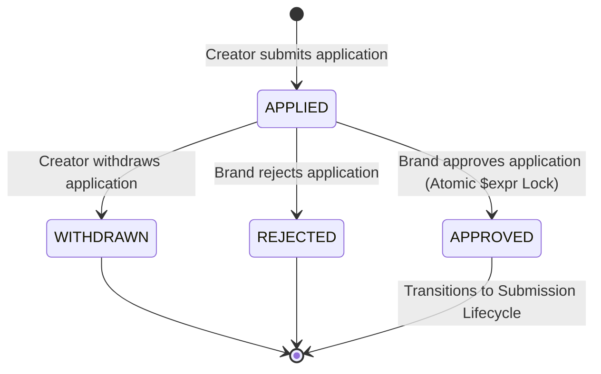
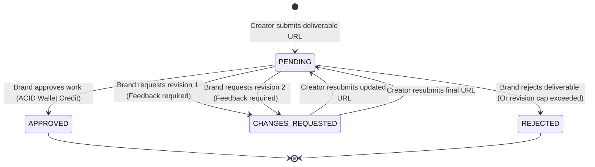
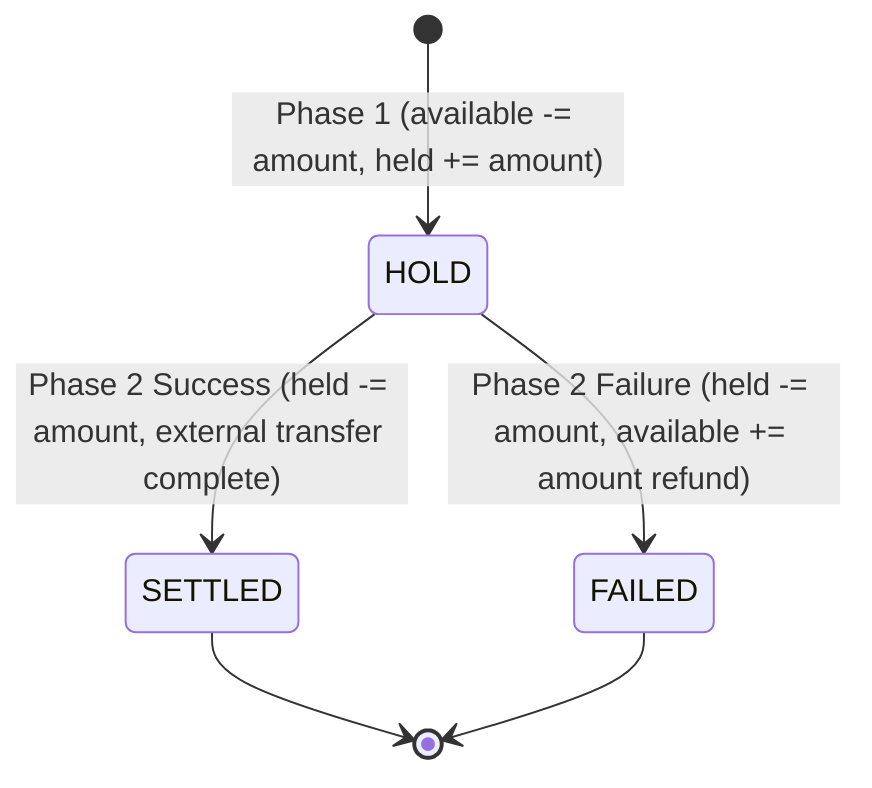

# PayPost: Complete Technical Documentation & Engineering Specifications

<div align="center">


<p align="center">
  <b>Comprehensive Engineering Manual, API Specifications, Database Schemas, Concurrency Protections, and Deployment Protocols for PayPost.</b>
</p>

</div>

---

## 📑 Table of Contents

1. [Executive Summary & Core Mission](#1-executive-summary--core-mission)
2. [Complete System Architecture & Directory Map](#2-complete-system-architecture--directory-map)
3. [Domain Models & Database Schema Audit (8 Entities)](#3-domain-models--database-schema-audit-8-entities)
4. [Financial Engine & Double-Entry Accounting Specifications](#4-financial-engine--double-entry-accounting-specifications)
5. [State Machines & Transition Lifecycle Specifications](#5-state-machines--transition-lifecycle-specifications)
6. [Complete REST API Reference & Request-Response Envelopes](#6-complete-rest-api-reference--request-response-envelopes)
7. [Asynchronous Workers & Outbox Pipeline](#7-asynchronous-workers--outbox-pipeline)
8. [Security, RBAC & Concurrency Defense Matrix](#8-security-rbac--concurrency-defense-matrix)
9. [Mobile-First Frontend Architecture & Component Tokens](#9-mobile-first-frontend-architecture--component-tokens)
10. [Production Deployment & DevOps Runbook](#10-production-deployment--devops-runbook)

---

## 1. Executive Summary & Core Mission

**PayPost** is an enterprise-grade creator collaboration and payout marketplace built specifically for the Indian influencer marketing ecosystem (inspired by UGCIndia). 

### The Core Problem Solved
Traditional creator platforms suffer from:
1. **Uncertain Creator Take-Home:** Creators are promised ₹5,000 but receive arbitrary deductions at payout time with zero audit trail.
2. **Double-Spend & Over-Allocation Races:** Multiple creators click "Apply" or brands click "Approve" simultaneously, resulting in more slots approved than the brand budgeted.
3. **Infinite Revision Traps:** Brands hold deliverables hostage with dozens of revision requests without paying creators.
4. **Late-Night Notification Violations:** Creators receive automated alert pings at 2:00 AM, breaching Indian telecom regulations (TRAI).

### PayPost's Architectural Guarantees
- **Zero-Drift Financials:** Every calculation operates exclusively in **Integer Paise** (`₹1 = 100 paise`), satisfying `Platform Fee + GST + TDS + Net === Gross` with exact conservation of money.
- **Immutable Double-Entry Ledger:** Balance changes are backed by cryptographically hashed, append-only journal entries.
- **Single-Statement Atomic Slot Locking:** MongoDB `$expr` conditional operators prevent slot over-allocations under extreme concurrent load.
- **Two-Revision Hard Cap:** Strict state machines block brands from requesting more than 2 revisions, with dynamic +48h fair deadline calculation.
- **Zero-Dependency TRAI Quiet Hours:** Outbox pipeline evaluates pure UTC arithmetic (+330 min) to hold notifications between 9:00 PM and 9:00 AM IST.

---

## 2. Complete System Architecture & Directory Map

PayPost follows a decoupled monorepo topology with strict layer isolation:

```
d:\PayPost\
├── backend/
│   ├── src/
│   │   ├── config/             # DB connection, environment configuration, constants
│   │   ├── controllers/        # HTTP DTO extraction, status code mapping, response envelopes
│   │   ├── middleware/         # JWT verification, RBAC guards, error handling, rate limiting
│   │   ├── models/             # Mongoose schemas, unique indexes, immutable pre-save hooks
│   │   ├── routes/             # Express route declarations mapped to controllers
│   │   ├── services/           # Domain business logic, ACID transactions, financial calculations
│   │   ├── utils/              # Integer math, pure UTC time math, logger helpers
│   │   ├── workers/            # Background polling workers (UPI reconciliation & Outbox queue)
│   │   └── server.js           # Server bootstrap and graceful shutdown handlers
│   ├── tests/                  # 15 Jest test suites (203 automated in-memory tests)
│   └── package.json            # CommonJS backend dependencies & npm scripts
├── frontend/
│   ├── src/
│   │   ├── api/                # Axios instance, interceptors, and typed API client modules
│   │   ├── components/         # Reusable UI components (ResponsiveList, Modal, StatCard, Icon)
│   │   ├── context/            # AuthContext, ToastContext, Theme/State providers
│   │   ├── hooks/              # Custom hooks (useDocumentTitle, useDebounce, usePolling)
│   │   ├── pages/              # Role-specific views (BrandDashboard, CreatorWallet, Campaigns)
│   │   ├── App.jsx             # React Router routing & ProtectedRoute wrappers
│   │   └── index.css           # Tailwind CSS directives & responsive design tokens
│   └── package.json            # Vite + React 18 configuration
└── docs/
    ├── diagrams/               # 25 master Mermaid architectural diagrams & workflows
    ├── ai-logs/                # AI conversation prompts, decisions, and development audit trails
    ├── ARCHITECTURE.md         # Full architectural decision log across 10 engineering phases
    ├── TESTING.md              # Invariant definitions and risky test runner mapping
    ├── TEST_CASES.md           # Exhaustive test case verification tables across 15 suites
    └── WALKTHROUGH.md          # Step-by-step evaluation cheat sheet for live technical calls
```

---

## 3. Domain Models & Database Schema Audit (8 Entities)

PayPost models all persistence through 8 tightly coupled entities with Mongoose validation rules and compound unique indexes:

### 1. `User` Entity
*Stores authentication credentials, contact details, and role claims.*
- `_id`: `ObjectId` (Primary Key)
- `email`: `String` (Required, unique, trimmed, lowercase)
- `passwordHash`: `String` (Bcrypt salted hash with 10 rounds)
- `name`: `String` (Required, trimmed)
- `role`: `Enum ['brand', 'creator', 'admin']` (Immutable after registration)
- `phone`: `String` (Optional, E.164 formatted string for WhatsApp/SMS notifications)
- `notificationPreferences`: `Object` (`{ email: Boolean, inApp: Boolean, whatsapp: Boolean }`)
- `createdAt`, `updatedAt`: `Date`

### 2. `CreatorProfile` Entity
*Stores creator portfolio, social metrics, and payout metadata.*
- `userId`: `ObjectId` (References `User`, unique)
- `bio`: `String` (Max 500 chars)
- `instagramHandle`: `String` (Sanitized alphanumeric handle)
- `upiId`: `String` (Validated VPA format, e.g. `username@bank`)
- `categories`: `[String]` (e.g. `['Beauty', 'Fashion', 'Tech']`)

### 3. `Campaign` Entity
*Represents marketing briefs created by brands with budget constraints.*
- `brandId`: `ObjectId` (References `User`)
- `title`: `String` (Required, max 100 chars)
- `brief`: `String` (Required markdown brief)
- `requirements`: `[String]` (Deliverable instructions)
- `perCreatorFeePaise`: `Number` (Integer paise gross reward per approved creator)
- `totalSlots`: `Number` (Integer, minimum 1)
- `approvedCount`: `Number` (Integer, tracks locked slots; `0 <= approvedCount <= totalSlots`)
- `totalBudgetPaise`: `Number` (Total allocated campaign budget in integer paise)
- `status`: `Enum ['DRAFT', 'OPEN', 'IN_PROGRESS', 'COMPLETED', 'CANCELLED']`
- `submissionDeadline`: `Date` (Deliverable submission cutoff)
- `startDate`, `endDate`: `Date` (`startDate < endDate` invariant)

### 4. `Application` Entity
*Tracks creator proposals and slot locking lifecycle.*
- `campaignId`: `ObjectId` (References `Campaign`)
- `creatorId`: `ObjectId` (References `User`)
- `pitch`: `String` (Optional proposal message)
- `status`: `Enum ['APPLIED', 'APPROVED', 'REJECTED', 'WITHDRAWN']`
- **Compound Unique Index:** `[campaignId, creatorId]` (Guarantees one active application per campaign)

### 5. `Submission` Entity
*Manages submitted content links and review revisions.*
- `campaignId`: `ObjectId` (References `Campaign`)
- `creatorId`: `ObjectId` (References `User`)
- `deliverableUrl`: `String` (Validated Instagram Post/Reel regex)
- `status`: `Enum ['PENDING', 'CHANGES_REQUESTED', 'APPROVED', 'REJECTED']`
- `revisionCount`: `Number` (Integer counter; hard-capped at `2`)
- `feedbackHistory`: `[{ reviewerId: ObjectId, note: String, createdAt: Date }]`
- `resubmitDeadline`: `Date` (Set to `max(originalDeadline, now + 48h)`)

### 6. `Wallet` Entity
*Maintains creator liquidity with separate available and held balances.*
- `creatorId`: `ObjectId` (References `User`, unique)
- `availableBalancePaise`: `Number` (Spendable/withdrawable balance in integer paise)
- `heldBalancePaise`: `Number` (Funds locked in active in-flight UPI payout)
- `totalEarnedPaise`: `Number` (Cumulative lifetime gross earnings)
- `totalWithdrawnPaise`: `Number` (Cumulative lifetime successful disbursements)

### 7. `LedgerEntry` Entity
*Tamper-proof, append-only journal documenting all financial movements.*
- `walletId`: `ObjectId` (References `Wallet`)
- `transactionType`: `Enum ['CREDIT', 'DEBIT_HOLD', 'DEBIT_SETTLE', 'REFUND_HOLD']`
- `amountPaise`: `Number` (Unsigned integer paise amount)
- `feeBreakdown`: `Object` (`{ platformFeePaise, gstPaise, tdsPaise, netPaise }`)
- `referenceType`: `Enum ['SUBMISSION_APPROVAL', 'WITHDRAWAL']`
- `referenceId`: `ObjectId` (References `Submission` or `Withdrawal`)
- `checksum`: `String` (Cryptographic verification hash)
- **Immutability Enforcement:** Mongoose pre-save and pre-remove hooks reject modifications and deletions.

### 8. `NotificationOutbox` Entity
*Transactional outbox queue ensuring reliable messaging without dual-write bugs.*
- `recipientId`: `ObjectId` (References `User`)
- `channel`: `Enum ['IN_APP', 'EMAIL', 'WHATSAPP']`
- `event`: `String` (e.g. `'application.approved'`, `'submission.revision_requested'`)
- `payload`: `Object` (Template interpolation parameters)
- `status`: `Enum ['QUEUED', 'SENT', 'FAILED', 'DROPPED']`
- `scheduledFor`: `Date` (Calculated next daylight time if enqueued during quiet hours)
- `attempts`: `Number` (Retry counter, max 3)

---

## 4. Financial Engine & Double-Entry Accounting Specifications

### Integer Paise Rule (Standard IEEE 754 Elimination)
In PayPost, every monetary value is an unsigned 64-bit safe integer:
$$\text{Paise} = \text{Rupees} \times 100$$

### Exact Statutory Tax Deduction Formulas
When a deliverable with gross reward $G$ paise is approved:
1. **Platform Fee (10% Commission):**
   $$PF = \left\lfloor G \times 0.10 \right\rfloor$$
2. **GST on Platform Fee (18% Statutory Rate):**
   $$GST = \left\lfloor PF \times 0.18 \right\rfloor$$
3. **TDS Withholding (1% Section 194J / 194C):**
   $$TDS = \left\lfloor G \times 0.01 \right\rfloor$$
4. **Creator Net Credit:**
   $$N = G - PF - GST - TDS$$

### Double-Entry Balance Invariant Proof
At all times across the system:
$$\Delta = (PF + GST + TDS + N) - G = 0 \text{ paise}$$
$$\text{Wallet Available} + \text{Wallet Held} \equiv \sum (\text{Ledger Credits}) - \sum (\text{Ledger Debits})$$

---

## 5. State Machines & Transition Lifecycle Specifications

### 1. Application Lifecycle State Machine


### 2. Deliverable & Revision State Machine (2-Revision Cap)


### 3. Two-Phase UPI Withdrawal State Machine


---

## 6. Complete REST API Reference & Request-Response Envelopes

All API endpoints return standard unified JSON envelopes:
- **Success:** `{ success: true, data: { ... } }`
- **Failure:** `{ success: false, error: { message: "...", code: "..." } }`

### Summary API Directory

| Method | Endpoint | Auth | Role | Description |
|---|---|---|---|---|
| `POST` | `/api/auth/register` | None | Public | Register new brand or creator account. |
| `POST` | `/api/auth/login` | None | Public | Authenticate credentials and receive JWT. |
| `GET` | `/api/auth/me` | Bearer | Any | Fetch authenticated user profile & permissions. |
| `GET` | `/api/campaigns` | None | Public | Browse public open campaigns with filters. |
| `POST` | `/api/campaigns` | Bearer | Brand | Create new campaign brief with budget locking. |
| `GET` | `/api/campaigns/:id` | None | Public | Fetch detailed campaign brief and slot status. |
| `POST` | `/api/applications` | Bearer | Creator | Submit one-click application for a campaign. |
| `POST` | `/api/applications/:id/approve` | Bearer | Brand | Atomically approve creator and lock slot. |
| `POST` | `/api/applications/:id/reject` | Bearer | Brand | Reject creator application. |
| `POST` | `/api/applications/:id/withdraw` | Bearer | Creator | Self-service application withdrawal. |
| `POST` | `/api/submissions` | Bearer | Creator | Submit Instagram Post/Reel deliverable URL. |
| `POST` | `/api/submissions/:id/review` | Bearer | Brand | Approve, reject, or request revision (feedback mandatory). |
| `GET` | `/api/wallet` | Bearer | Creator | Fetch creator balance (`available`, `held`, ledger history). |
| `POST` | `/api/wallet/withdraw` | Bearer | Creator | Initiate Phase-1 UPI payout hold (min ₹100). |
| `GET` | `/api/dashboard/brand/attention` | Bearer | Brand | Fetch single-query Brand Action Center aggregation. |
| `GET` | `/api/dashboard/creator/actions` | Bearer | Creator | Fetch prioritized Next Actions banner chips. |
| `GET` | `/api/health` | None | Public | System uptime and MongoDB connectivity check. |

---

## 7. Asynchronous Workers & Outbox Pipeline

### 1. Withdrawal Reconciliation Worker (`workers/withdrawalWorker.js`)
- **Polling Cadence:** Every `3000ms`.
- **Concurrency Isolation:** Banking gateway API calls are dispatched **outside of database ACID sessions** to prevent long-lived database locks.
- **Crash Recovery:** Automatically queries withdrawals stuck in `HOLD` for $>60\text{s}$; fetches idempotent provider status and either settles the transaction or refunds the creator's wallet.

### 2. TRAI Quiet-Hours Outbox Worker (`workers/notificationWorker.js`)
- **Polling Cadence:** Every `5000ms`.
- **Pure UTC Time Arithmetic:**
  $$\text{IST Minute of Day} = ((\text{UTC Hour} \times 60 + \text{UTC Minute}) + 330) \pmod{1440}$$
  $$\text{Quiet Window:} \quad 1260 \le \text{Minute} < 1440 \quad \lor \quad 0 \le \text{Minute} < 540 \quad (21:00 \text{ to } 09:00 \text{ IST})$$
- If quiet hours are active, non-critical notifications are rescheduled to `03:30:00.000 UTC` (9:00 AM IST next morning).
- **Send-Time Opt-Out Verification:** Checks recipient preferences at the exact moment of dispatch to guarantee user preferences are honored even after queuing.

---

## 8. Security, RBAC & Concurrency Defense Matrix

| Security Domain | Implementation | Threat Prevented |
|---|---|---|
| **Password Security** | Bcrypt salted hash with 10 salt rounds | Rainbow tables and credential database leaks |
| **Authentication** | Stateless HMAC-SHA256 JWT (7-day validity) | Session hijacking & server memory bloat |
| **Role-Based Guards** | `requireRole('brand')`, `requireRole('creator')` | Privilege escalation and unauthorized state mutation |
| **Application Slot Races** | MongoDB `$expr: { $lt: ["$approvedCount", "$totalSlots"] }` | Double-booking slots during viral traffic spikes |
| **Concurrent Withdrawals** | Multi-document ACID session with immediate hold | Double-spend attacks draining creator wallets |
| **URL Deduplication** | Campaign-scoped unique index on Instagram URL | Re-submitting identical posts across multiple creators |
| **Secret Scanning** | Automated pre-commit scanner (`npm run check:secrets`) | Accidental leakage of API keys or `.env` credentials into git |

---

## 9. Mobile-First Frontend Architecture & Component Tokens

### 360px Mobile-First Philosophy
The frontend UI is designed from the smallest mobile screen (`360px` width) upwards, progressively enhancing for tablet (`768px`) and desktop (`1024px+`):
- **Responsive Lists:** Tables on desktop automatically morph into touch-friendly cards on mobile via `<ResponsiveList />`.
- **Touch Targets:** All interactive buttons and inputs adhere to a minimum height of `44px`.
- **Action Center:** Single-query aggregation card providing one-touch approval/rejection without navigating between separate tabs.
- **Deep Linking Navigation:** Supports `?tab=submissions&focus=<id>` with smooth scrolling and CSS pulse animations.
- **Zero Heavy UI Kits:** Built entirely with Tailwind CSS utility tokens and inline SVGs from `<Icon />` to ensure sub-50KB bundle sizes.

---

## 10. Production Deployment & DevOps Runbook

### Cloud Deployment Topologies
- **Frontend SPA:** Hosted on **Vercel** with automatic client routing rewrites (`vercel.json`).
- **Backend API Server & Workers:** Hosted on **Render** (Node.js Web Service) running API server and background workers simultaneously.
- **Database:** Hosted on **MongoDB Atlas** (M0 Replica Set) with automated encryption at rest and TLS 1.3 in transit.

### Environment Secrets Runbook
In production, environment variables are securely injected through the host cloud provider's encrypted secrets vault:
```env
# Backend (Render Secrets)
PORT=5000
MONGODB_URI=mongodb+srv://<user>:<password>@<cluster>.mongodb.net/paypost?retryWrites=true&w=majority
JWT_SECRET=super_secret_cryptographic_key_min_32_characters
CLIENT_URL=https://paypost.vercel.app
WORKER_ENABLED=true
NOTIFICATION_WORKER_ENABLED=true

# Frontend (Vercel Environment Variables)
VITE_API_URL=https://paypost-backend.onrender.com/api
```

---

## 📄 License & Attribution

This project is licensed under the **MIT License**.  
**Author:** Kasim Shah  
**Portfolio:** [kasim-portfolio-umber.vercel.app](https://kasim-portfolio-umber.vercel.app/)  
**GitHub:** [@kasimshah19](https://github.com/kasimshah19)  
**LinkedIn:** [Kasim Shah](https://www.linkedin.com/in/kasim-shah-176175340/)  

<div align="center">
  <p>© 2026 PayPost — Creator Deliverables & Financial Settlement Engine. All rights reserved.</p>
</div>
