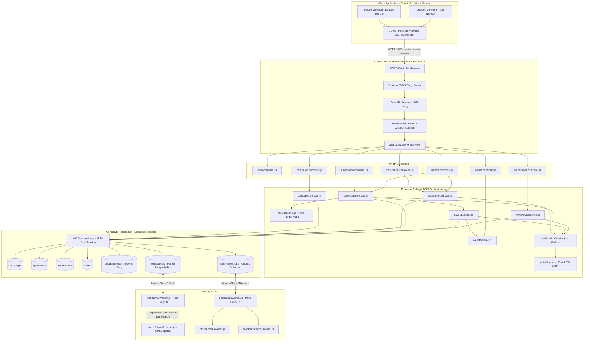

# 01. System Topology & Decoupled Architecture

This diagram illustrates the layered software architecture of PayPost, detailing how HTTP requests travel from the client SPA through validation, authentication, business services, and database ACID transactions, alongside the background worker polling loops.

---

