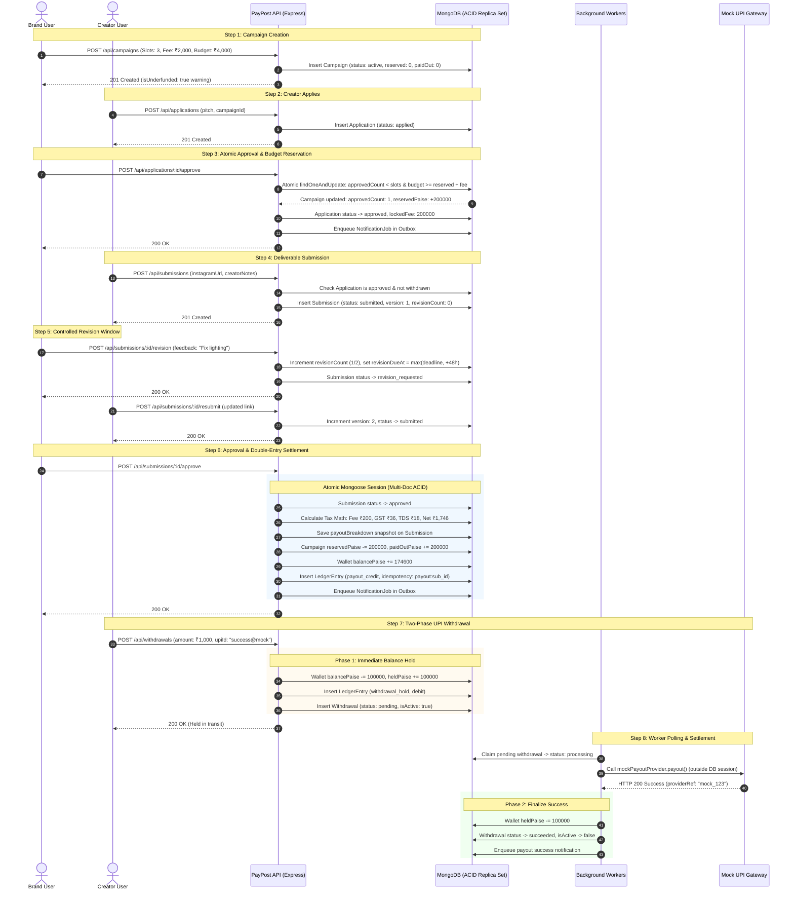

# 02. End-to-End Campaign & Deliverable Lifecycle

This sequence diagram depicts the chronological interactions between the **Brand**, **Creator**, **Backend API**, **Database**, and **Background Workers** from campaign creation through deliverable review, wallet settlement, and UPI withdrawal.

---

