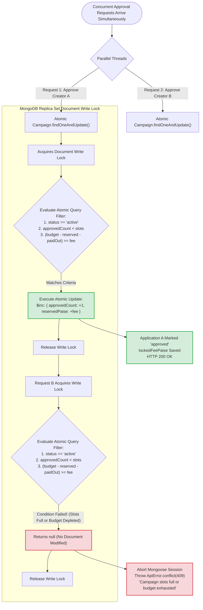

# 03. Atomic Slot & Budget Reservation (Concurrency Race Protection)

This flowchart illustrates how PayPost completely prevents slot over-allocation and budget over-subscription when multiple approvals occur in parallel at the exact same millisecond.

---

### The Problem: Read-Then-Write Vulnerability
In a naive implementation:
1. Thread A reads: `slots available = 1, budget available = ₹2,000`.
2. Thread B reads: `slots available = 1, budget available = ₹2,000`.
3. Thread A writes: Approves Creator 1 (`slots = 2/2`, budget used = ₹2,000).
4. Thread B writes: Approves Creator 2 (`slots = 3/2` 💥 **OVER-ALLOCATION!**, budget exceeded).

---

### The PayPost Solution: Single Atomic Conditional Update



---

### Exact Mongoose Query Implementation
```javascript
const updatedCampaign = await Campaign.findOneAndUpdate(
  {
    _id: campaignId,
    status: CAMPAIGN_STATUS.ACTIVE,
    approvedCount: { $lt: campaign.slots },
    $expr: {
      $gte: [
        { $subtract: ["$budgetPaise", { $add: ["$reservedPaise", "$paidOutPaise"] }] },
        feePaise
      ]
    }
  },
  {
    $inc: { approvedCount: 1, reservedPaise: feePaise }
  },
  { new: true, session }
);

if (!updatedCampaign) {
  const err = new Error('Campaign has no available slots or insufficient budget');
  err.status = 409;
  throw err;
}
```
