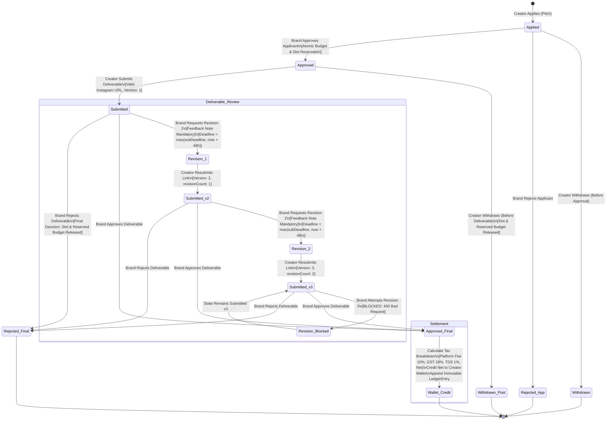

# 04. Deliverable Review & 2-Revision State Machine

This state chart outlines the allowed lifecycle states, transitions, guard conditions, and financial consequences of deliverable reviews in PayPost.

---

---

### Transition Rules & Financial Consequences Matrix

| Transition | Actor | Pre-Conditions | Financial & Slot Consequence |
|---|---|---|---|
| **Apply** | Creator | Campaign active, before deadline | None |
| **Withdraw (Applied)** | Creator | Status is `applied` | None. Eligible to re-apply before deadline. |
| **Approve Application** | Brand | Available slots & remaining budget | `reservedPaise += fee`, `approvedCount += 1`. |
| **Withdraw (Approved)** | Creator | Status is `approved`, no deliverable | `reservedPaise -= fee`, `approvedCount -= 1`. Cannot re-apply. |
| **Submit Deliverable** | Creator | Status is `approved`, valid Instagram link | Application locked; withdrawal blocked. |
| **Request Revision** | Brand | `revisionCount < 2`, mandatory feedback | Resubmit deadline extended to `max(deadline, now + 48h)`. |
| **Resubmit** | Creator | Status is `revision_requested`, before `revisionDueAt` | `version += 1`, resets to `submitted`. |
| **Reject Deliverable** | Brand | Deliverable in review | Final rejection. `reservedPaise -= fee`, `approvedCount -= 1`. Slot recycled. |
| **Approve Deliverable** | Brand | Deliverable in review | `reservedPaise -= fee`, `paidOutPaise += fee`. Net credited to creator wallet. |
