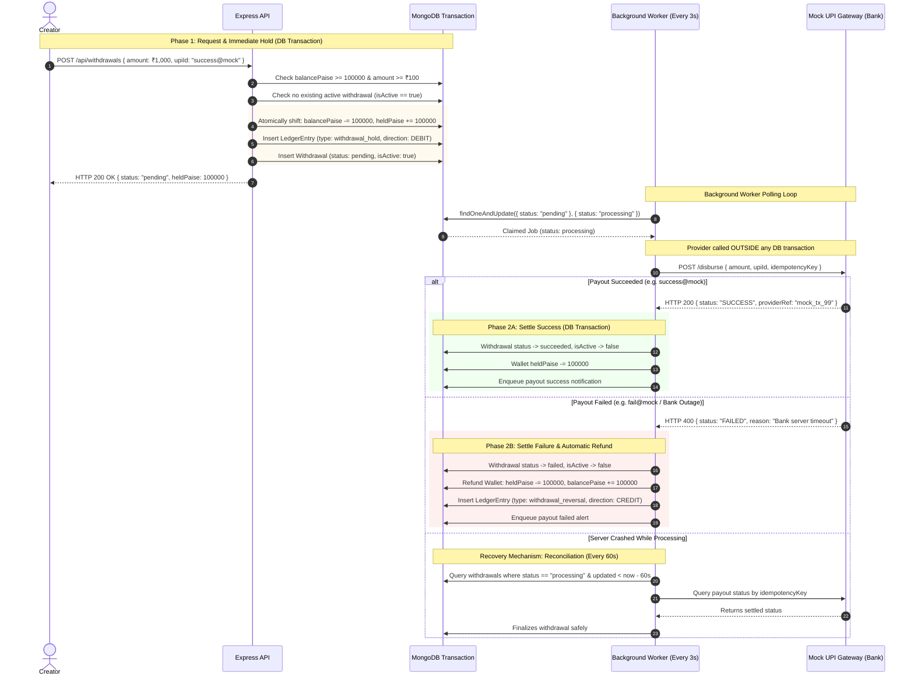

# 06. Two-Phase Hold-and-Settle UPI Withdrawal & Reconciliation

This diagram shows how PayPost handles creator payouts using an asynchronous two-phase hold-and-settle pattern to ensure external gateway delays never hold open database locks, and crashes are self-healing.

---

