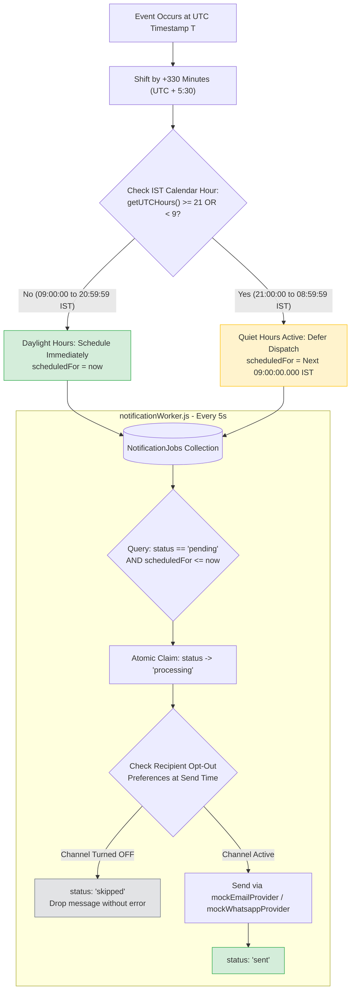

# 07. Transactional Outbox & TRAI-Compliant Quiet Hours Dispatcher

This diagram illustrates how PayPost completely avoids dual-write notification failures using an Outbox collection, and schedules promotional messages to honor Telecom Regulatory Authority of India (TRAI) quiet hours (9:00 PM to 9:00 AM IST).

---

### Dual-Write Problem vs. Transactional Outbox

```mermaid
flowchart TD
    subgraph AntiPattern [The Broken Dual-Write Anti-Pattern]
        BusinessOp1[Execute Business Update in DB] --> DirectAPI[Call SendGrid / Twilio API Directly]
        DirectAPI -- Network Fails / Timeout! --> DBAbort[DB Aborts Transaction]
        DirectAPI -- Email Sent! --> DBCrash[Server Crashes Before Commit]
        DBCrash --> Inconsistent[💥 Inconsistent: User receives email for phantom action]
    end

    subgraph OutboxPattern [The PayPost Transactional Outbox Solution]
        Session[Start Mongoose ClientSession]
        BizUpdate[1. Update Business State: e.g. Approve Submission]
        EvalQuiet[2. Pure UTC Quiet Hours Check: UTC+5:30 Math]
        OutboxInsert[3. Insert NotificationJob in Outbox Collection]
        Commit[4. session.commitTransaction()]

        Session --> BizUpdate
        BizUpdate --> EvalQuiet
        EvalQuiet --> OutboxInsert
        OutboxInsert --> Commit
        
        Commit --> Guaranteed[Guaranteed: If DB commits, job is queued.<br/>If DB rolls back, job is erased.]
    end

    style AntiPattern fill:#f8d7da,stroke:#dc3545,stroke-width:2px;
    style OutboxPattern fill:#d4edda,stroke:#28a745,stroke-width:2px;
```

---

### Pure UTC Quiet Hours Scheduling Logic


