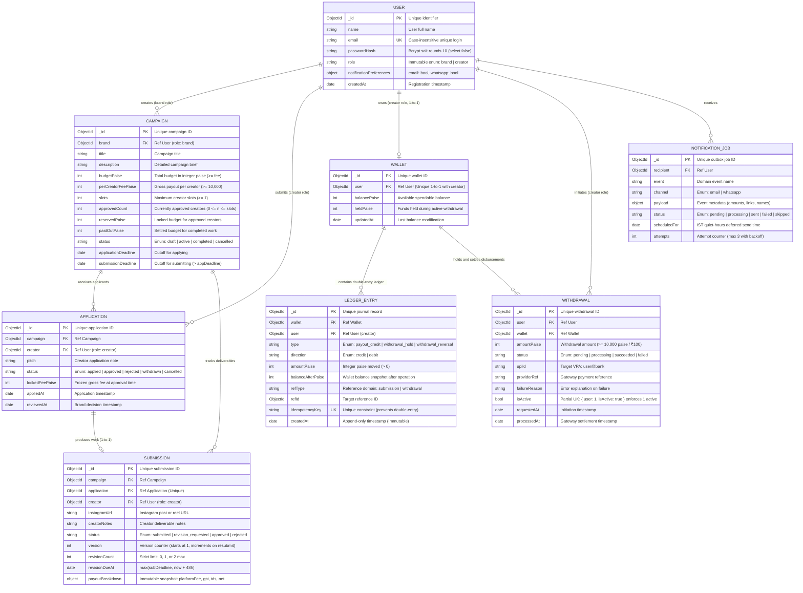

# 08. Complete Database Entity-Relationship (ER) Diagram & Deep Schema Audit

This document provides the authoritative Entity-Relationship (ER) model of PayPost, complete with field types, relationship cardinalities, unique indexes, foreign key references, and an exhaustive explanation of every entity and design choice.

---

## 1. Visual Entity-Relationship Diagram

---

## 2. Exhaustive Schema Explanation & Entity Purpose

### Entity 1: `User` (Core Identity & RBAC)
- **Purpose**: Represents brands and creators on the platform.
- **Key Design Decision**: The `role` field (`'brand'` or `'creator'`) is chosen at registration and is completely **immutable**. A brand can never become a creator and vice versa, which prevents privilege escalation and simplifies route authorization middleware.
- **Indexes**: Unique index on `email` (case-insensitive).

### Entity 2: `Campaign` (Collaboration Brief & Budget Meter)
- **Purpose**: Created by brands to solicit promotional Instagram posts.
- **Key Design Decision**: Maintains two real-time financial tracking counters: `reservedPaise` (funds committed to approved creators who haven't finished work yet) and `paidOutPaise` (funds finalized on deliverable approval). The fundamental invariant `reservedPaise + paidOutPaise <= budgetPaise` is strictly enforced via atomic conditional queries.
- **Validation**: `submissionDeadline` must always be strictly after `applicationDeadline`.

### Entity 3: `Application` (Creator Bidding & Commitment)
- **Purpose**: Records a creator's application to a campaign.
- **Key Design Decision**: Contains `lockedFeePaise`. When an applicant is approved, the campaign's current `perCreatorFeePaise` is copied here permanently. If the brand later updates the campaign fee for future applicants, the approved creator is legally insulated and receives their locked fee.

### Entity 4: `Submission` (Deliverable & Review State)
- **Purpose**: Stores the creator's submitted work (Instagram post or reel link).
- **Key Design Decision**: Enforces a strict two-revision limit (`revisionCount <= 2`). Stores an embedded `payoutBreakdown` object snapshot upon brand approval. This freezes statutory tax deductions (Platform fee, GST, TDS) permanently.

### Entity 5: `Wallet` (Balance Cache)
- **Purpose**: Represents the creator's current financial balance.
- **Key Design Decision**: Contains two separate buckets: `balancePaise` (available for withdrawal) and `heldPaise` (locked while an external payment gateway processes an active withdrawal). Wallet balance is technically a cached view of the ledger; `integrityService` validates that `balancePaise === sum(ledger credits) - sum(ledger debits)`.

### Entity 6: `LedgerEntry` (The Single Source of Truth)
- **Purpose**: Double-entry financial journal.
- **Key Design Decision**: **Strict Immutability**. Mongoose schema pre-hooks intercept and throw an exception on any `updateOne`, `updateMany`, or `deleteOne` call. Financial history can never be modified. A unique index on `idempotencyKey` prevents duplicate entries.

### Entity 7: `Withdrawal` (Hold-and-Settle Disbursements)
- **Purpose**: Tracks UPI disbursements to the creator's bank account.
- **Key Design Decision**: Enforces a **partial unique index** `{ user: 1, isActive: true }`. When a withdrawal is active, `isActive` is `true`. This guarantees at the database engine level that a creator cannot spawn concurrent parallel withdrawals.

### Entity 8: `NotificationJob` (Transactional Outbox)
- **Purpose**: Ensures reliable, audit-compliant messaging.
- **Key Design Decision**: Notification jobs are created inside the exact same database transaction session as the triggering business event. If a transaction aborts, zero messages are saved. Scheduled timestamps (`scheduledFor`) respect TRAI India Standard Time (IST) quiet hours (9:00 PM to 9:00 AM).
