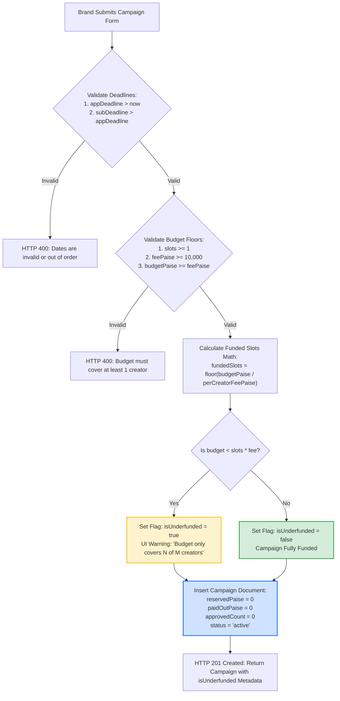

# 10. Campaign Creation, Funding Verification & Slot Math

This diagram illustrates how PayPost processes campaign creation, calculates funded slot capacities, detects underfunded campaigns without halting creation, and enforces deadline hierarchy constraints.

---

---

### What Is Happening in This Diagram:
- **Product Empathy vs. Financial Safety**: A brand might want to list 5 slots to gauge creator interest but only fund ₹4,000 upfront (enough for 2 creators at ₹2,000 each). PayPost **does not block creation**. It allows the campaign to publish, gives an informative warning in the UI, and relies on Phase 4's atomic approval guard to halt approvals once the budget runs dry.
