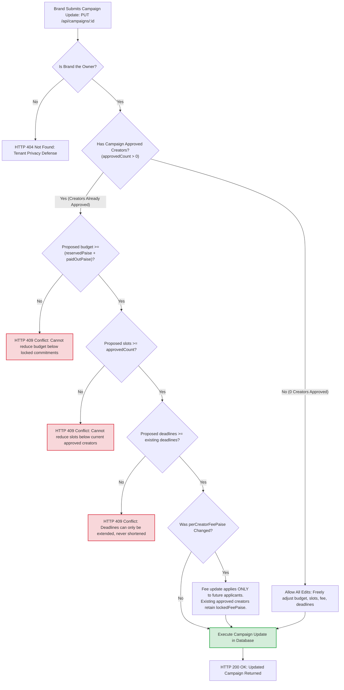

# 11. Post-Approval Campaign Modification & Constraint Pipeline

This diagram shows the safety guards that prevent brands from editing campaigns in ways that would disenfranchise already-approved creators or invalidate financial reservations.

---

---

### What Is Happening in This Diagram:
- Once creators are approved, a campaign is bound by commitments. If 2 creators are approved for ₹2,000 each (₹4,000 reserved), the brand cannot drop the budget to ₹3,000 or reduce slots to 1. Deadlines can only move forward into the future to give creators more time, never backwards.
