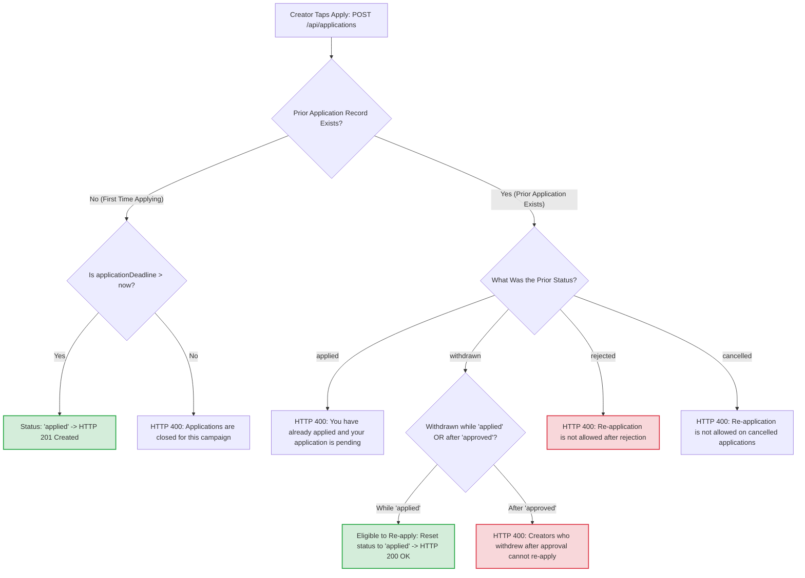

# 13. Creator Application, Withdrawal & Re-Application Rules

This decision tree shows whether a creator is eligible to re-apply to a campaign depending on their previous application history.

---

---

### What Is Happening in This Diagram:
- Prevents **"slot grabbing"**: A creator who applied and withdrew before the brand reviewed it can change their mind and re-apply. However, a creator who was approved (which locked a slot and budget) and then withdrew cannot re-apply, preventing creators from repeatedly holding up campaign slots.
