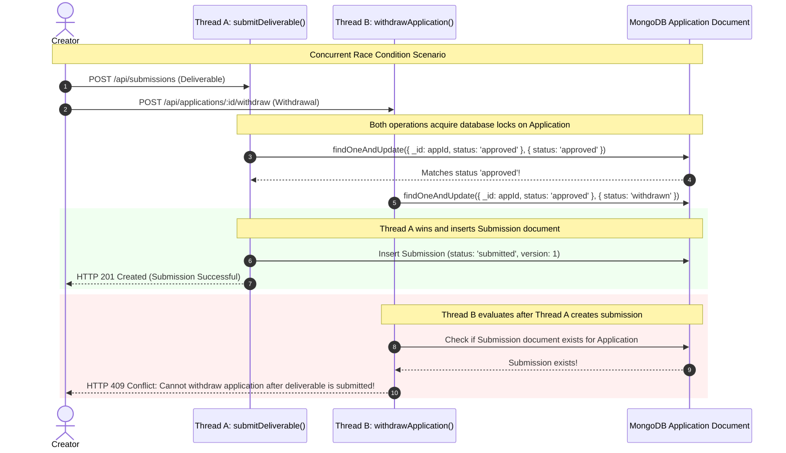

# 14. Mutual Exclusion Race: Deliverable Submission vs Application Withdrawal

This diagram demonstrates how PayPost prevents a race condition where a creator attempts to submit a deliverable and withdraw their application at the exact same millisecond.

---

---

### What Is Happening in This Diagram:
- If a creator could withdraw while submitting, they could trigger budget releases while still expecting a payout. Mutual exclusion ensures that once a deliverable exists, the application is locked into the review pipeline and cannot be withdrawn.
