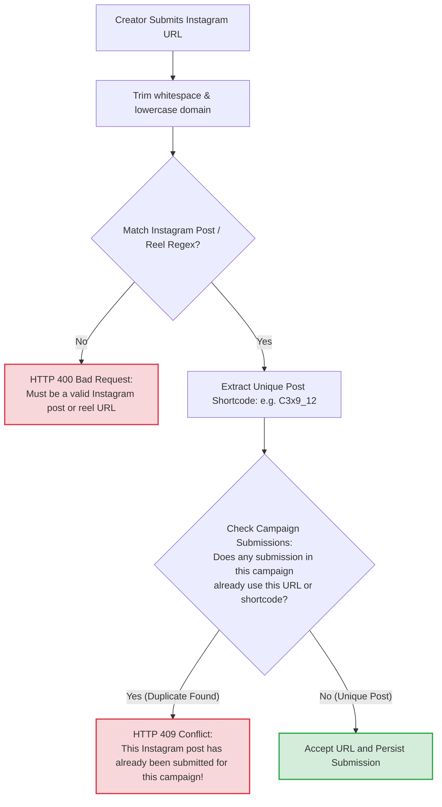

# 15. Instagram Deliverable URL Validation & Campaign Deduplication

This diagram outlines how deliverable links are sanitized, validated against strict Instagram patterns, and deduplicated across the campaign.

---



---

### Regex Pattern Implementation (`src/utils/instagram.js`):
```javascript
const INSTAGRAM_URL_REGEX = /^https?:\/\/(www\.)?instagram\.com\/(p|reel|tv)\/([a-zA-Z0-9_-]+)\/?.*$/;
```
