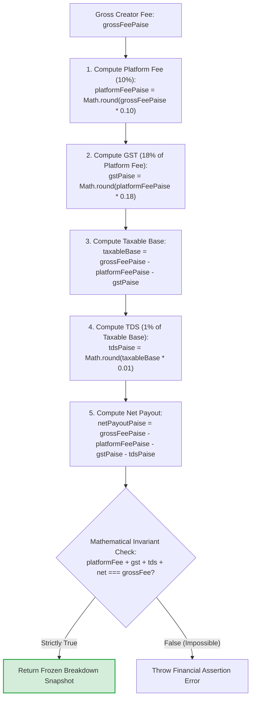

# 16. Statutory Indian Tax Math & Fee Engine (Zero Leakage)

This flowchart details the exact integer paise arithmetic used to compute statutory Indian tax deductions from creator payouts with zero rounding leakage.

---

---

### Example Numerical Proof Table

| Item | Math Formula | ₹1,000 Gross (Paise) | ₹2,500 Gross (Paise) |
|---|---|---|---|
| **Gross Fee** | Base agreed fee | 100,000 paise (₹1,000.00) | 250,000 paise (₹2,500.00) |
| **Platform Fee (10%)** | `round(gross * 0.10)` | 10,000 paise (₹100.00) | 25,000 paise (₹250.00) |
| **GST (18% of Fee)** | `round(fee * 0.18)` | 1,800 paise (₹18.00) | 4,500 paise (₹45.00) |
| **Taxable Base** | `gross - fee - gst` | 88,200 paise (₹882.00) | 220,500 paise (₹2,205.00) |
| **TDS (1% of Base)** | `round(base * 0.01)` | 882 paise (₹8.82) | 2,205 paise (₹22.05) |
| **Net Payout** | `gross - fee - gst - tds`| **87,318 paise (₹873.18)** | **218,295 paise (₹2,182.95)** |
| **Sum of Parts** | `fee + gst + tds + net` | **100,000 paise (₹1,000.00)** | **250,000 paise (₹2,500.00)** |
