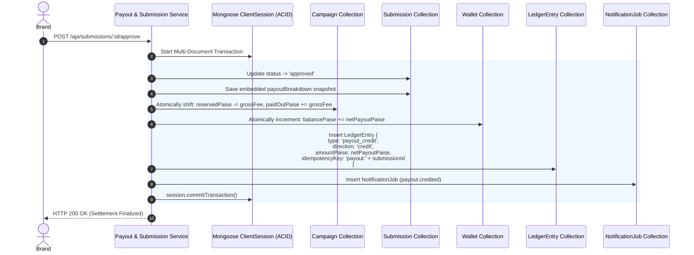

# 17. Deliverable Approval & Double-Entry Settlement Pipeline

This diagram shows the atomic multi-document database transaction executed when a brand clicks "Approve Submission".

---

---

### What Is Happening in This Diagram:
- All 5 operations (marking submission approved, shifting campaign funds, crediting wallet, writing the ledger entry, and enqueuing the outbox alert) occur inside a single atomic ACID transaction. If the server crashes or power fails halfway through, all 5 writes abort cleanly.
