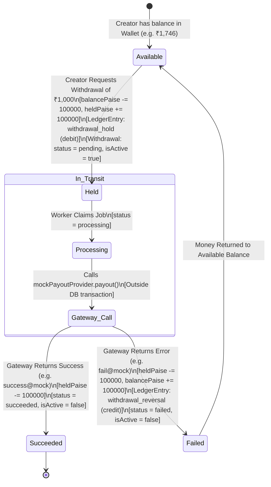

# 18. Withdrawal Two-Phase Hold-and-Settle State Transitions

This state transition chart explains how creator funds move between available balance, held balance, and final settlement during a UPI withdrawal.

---

---

### What Is Happening in This Diagram:
- At no point during the payout process can a creator double-spend funds. Money moves to `heldPaise` immediately upon request. If the bank fails, the funds are automatically reversed back to `balancePaise`.
