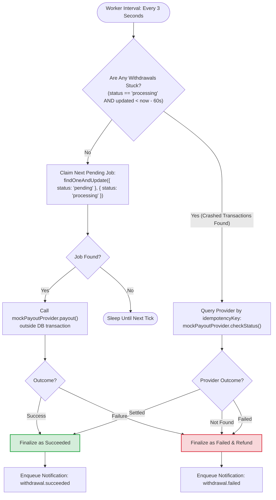

# 19. Withdrawal Worker Polling & Crash Reconciliation Engine

This flowchart shows how the background worker polls jobs and automatically recovers transactions stuck in `processing` status due to a server crash or network failure.

---

