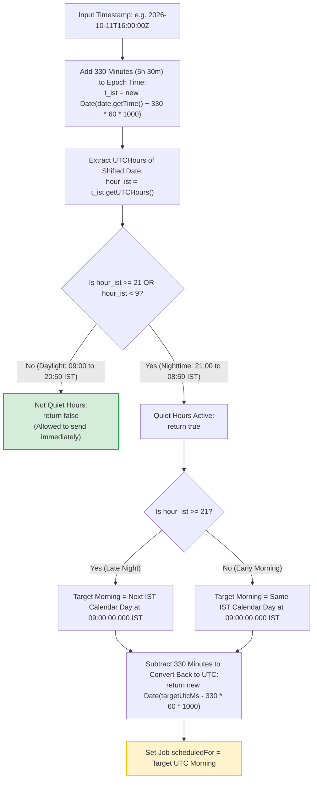

# 20. Pure UTC Quiet Hours Arithmetic & Timezone Normalization

This diagram demonstrates how India Standard Time (IST = UTC + 5:30) quiet hours are evaluated using pure UTC arithmetic without server timezone dependencies.

---

