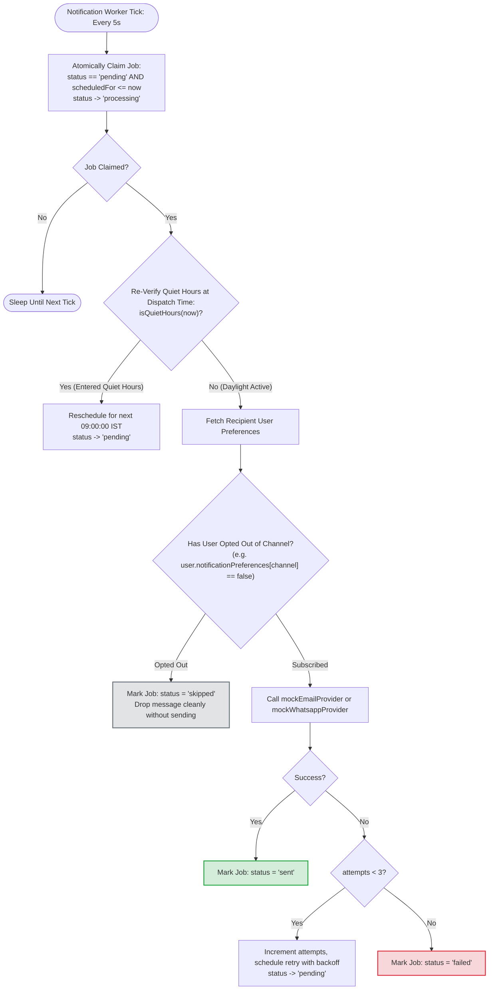

# 21. Notification Dispatch Worker & Dynamic Channel Opt-Out

This diagram shows how the notification worker dispatches jobs from the outbox and respects user channel opt-outs at the moment of send.

---

