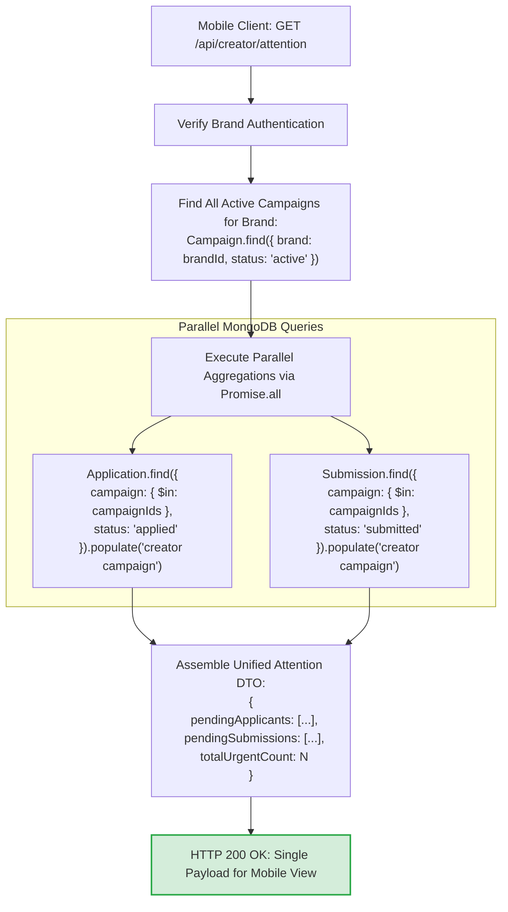

# 22. Brand Action Center Single-Query Aggregation Architecture

This diagram shows how the Brand Action Center endpoint aggregates urgent tasks across all campaigns into a single response to avoid mobile network request chatter.

---

