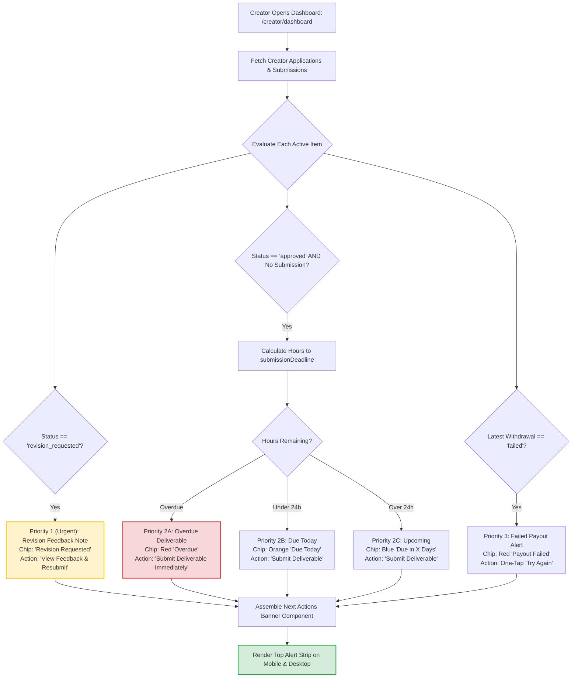

# 23. Creator Dashboard Next Actions & Deadline Urgency Engine

This diagram illustrates how the creator dashboard computes urgent action items and renders color-coded urgency countdown chips.

---

