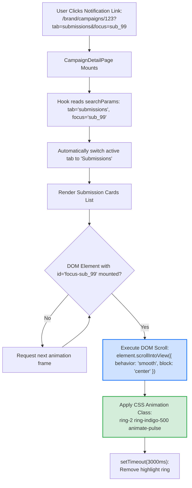

# 24. Deep-Link Navigation, Tab Selection & Pulse Highlight Flow

This diagram shows how PayPost handles deep-links from notifications (e.g. `?tab=submissions&focus=<id>`) to switch tabs and smoothly scroll target cards into view.

---

