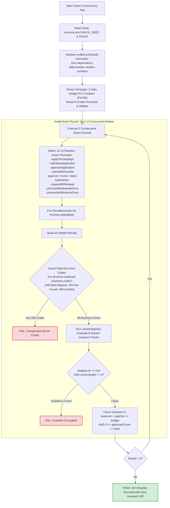

# 25. Seeded Concurrency Chaos Test Engine Architecture

This diagram illustrates how the `tests/chaos.test.js` concurrency test uses a deterministic `mulberry32` pseudo-random generator to stress-test real services in parallel.

---

