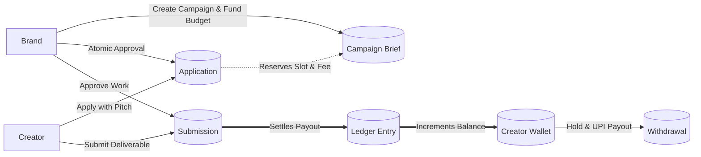

# PayPost — System Architecture & Workflow Diagrams

This directory contains comprehensive architectural diagrams, state machine transitions, financial balance flows, and sequence interactions for **PayPost**.

---

## Index of Diagrams

1. [High-Level System Topology & Decoupled Architecture](file:///d:/PayPost/docs/diagrams/01-system-topology.md)
2. [End-to-End Campaign & Deliverable Lifecycle](file:///d:/PayPost/docs/diagrams/02-campaign-lifecycle.md)
3. [Atomic Slot & Budget Reservation (Concurrency Race Protection)](file:///d:/PayPost/docs/diagrams/03-atomic-reservation-race.md)
4. [Deliverable Review & 2-Revision State Machine](file:///d:/PayPost/docs/diagrams/04-submission-revision-state-machine.md)
5. [Money Flow, Tax Breakdown & Double-Entry Ledger](file:///d:/PayPost/docs/diagrams/05-money-flow-and-ledger.md)
6. [Two-Phase Hold-and-Settle UPI Withdrawal & Reconciliation](file:///d:/PayPost/docs/diagrams/06-two-phase-withdrawals.md)
7. [Transactional Outbox & TRAI-Compliant Quiet Hours Dispatcher](file:///d:/PayPost/docs/diagrams/07-notification-outbox-quiet-hours.md)
8. [Complete Entity-Relationship (ER) Data Model](file:///d:/PayPost/docs/diagrams/08-database-er-model.md)

---

## Visual Summary of Key Flows

### 1. High-Level Flow Overview


### 2. Double-Entry Financial Movement
```mermaid
flowchart TD
    CampBudget[Campaign Budget ₹10,000] -->|Approve Creator ₹2,000| Reserved[Reserved Budget ₹2,000]
    Reserved -->|Deliverable Approved| PaidOut[Paid Out ₹2,000]
    
    subgraph Payout Breakdown [Statutory Tax Math]
        PaidOut -.-> PlatFee[Platform Fee ₹200 (10%)]
        PaidOut -.-> GST[GST ₹36 (18% of Fee)]
        PaidOut -.-> TDS[TDS ₹18 (1% of Base)]
        PaidOut ==> Net[Net Payout ₹1,746]
    end
    
    Net ==> LedgerCredit[Immutable Ledger Credit]
    LedgerCredit ==> AvailBal[Creator Available Balance ₹1,746]
    AvailBal -->|Withdraw ₹1,000| Held[Held in Transit ₹1,000]
    Held -->|Mock UPI Success| Settled[Disbursed to Bank Account]
```
